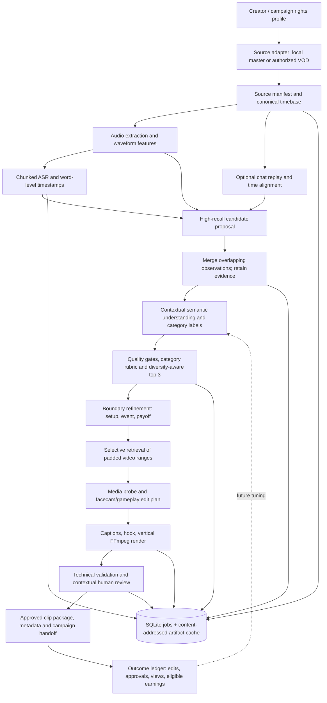

# Chomp-Chomp — Architecture Specification v1.0

**Status:** Proposed architecture, not an implemented or benchmark-validated system  
**Date:** 2026-11-14  
**Primary target:** Windows, local-first, economical processing of authorized completed stream VODs  
**Later evolution:** Batched VODs → continuous live ingestion  
**Primary outcome:** Up to 3 genuinely useful, nonduplicate, review-approved, upload-ready vertical clips per VOD, or zero when none passes quality gates

## 1. Explicit decisions

1. **VOD first.** Phase 1 analyzes completed recordings with audio-first extraction and selective video fetch. Phase 2 scales across multiple VODs. Phase 3 adds live recording by implementing a new source adapter without rewriting detectors/renderers.
2. **Broad discovery precedes category-specific scoring.** Don't restrict discovery to funny, anger or gaming events. Cheap detectors must preserve unusual and low-signal candidates, with control samples to estimate missed moments.
3. **Three initial evidence modalities:** audio characteristics, timestamped speech transcript, and available viewer chat. Chat is optional; absence is represented explicitly and is not a quality penalty.
4. **Discovery and understanding are conceptual stages**, not necessarily separate AI models. Reuse one transcript, timestamp map and feature cache. Expensive semantic inference is performed on promising contextual windows.
5. **Quality, not volume.** Rank candidates, select up to three distinct moments that pass hard gates, and output zero when appropriate. No forced category quotas or guaranteed virality predictions.
6. **Review before publishing.** Generates an approved export package and campaign metadata. Posting is initially manual; later integrations are gated, authorized and idempotent.

## 2. Architectural map



The recording/live path is a future adapter that emits the *same* `SourceManifest`, `TimedObservation`, transcript and chunk assets. Live analysis must never rely on future chat or whole-VOD statistics.

## 3. Modules and contracts

| Module | Responsibilities | Input | Output | Main reference from audited repos |
|---|---|---|---|---|
| `source` | Validate URL/file, permissions, metadata, source ID; expose audio and video range access | SourceSpec + RightsProfile | SourceManifest | Chopify sections; GTA sources |
| `audio` | Retrieve permitted audio, normalize, energy/LUFS features, speech activity, reaction cues | SourceManifest | AudioArtifact + TimedObservation[] | GTA signals, Chopify evidence |
| `transcribe` | Chunked ASR with overlap, merging, word timestamps, language and confidence | AudioArtifact | TranscriptWords[] | Chopify chunk reconcile; FunClip |
| `chat` | Available chat replay, user-diversity/rate/emote indicators, clock alignment | Chat source/fixture + manifest | TimedObservation[] + availability | Hypeline |
| `discover` | Parallel high-recall proposal lanes from audio, transcript and chat; cheap unbiased sampling | Observations + transcript | Candidate[] | GTA, Chopify, Hypeline |
| `understand` | Contextual semantic explanation, category label(s), evidence-anchored assessment | Candidate + transcript + audio metadata | JudgedCandidate[] | AutoClip, Chopify |
| `select` | Hard gates, calibrated score, suppress duplicates, balance near-ties, choose up to 3 | JudgedCandidate[] | SelectedCandidate[] | AutoClip boundaries; new implementation |
| `boundaries` | Snap to speech and event limits, recover setup and payoff | SelectedCandidate + word timestamps | ClipPlan | AutoClip |
| `fetch_video` | Get padded selected ranges, validate start offset and duration, coalesce nearby intervals | ClipPlan + SourceManifest | LocalMediaRange[] | Chopify sections; Hypeline HLS |
| `edit` | Facecam detection or manual ROI, protected gameplay area, caption styling, hooks, render | ClipPlan + media + profile | RenderedClip + EditSpec | Steezy, Chopify, OpenClipper patterns |
| `review` | Verify duration/codecs, caption presence, legibility, context, rights/campaign eligibility | RenderedClip + campaign profile | ApprovalDecision | New implementation |
| `handoff` | ZIP/project package, post caption, hashtags, attribution, required disclosures, source trail | Approved clips | ExportManifest | Publish state lessons from OpenClipper |
| `feedback` | Editor corrections, campaign acceptance, retention if available, payouts actually received | Outcome records | Metrics and future labeled examples | New implementation |
| `orchestrator` | Persistent jobs, retry, resource reservations and stage caching | Work requests | Stage job state | AutoClip SQLite; Chopify artifact reuse |

### Core type contracts

All source-relative times use **integer milliseconds**. Local UTC timestamps may supplement, but never replace, source-relative positions. Source-relative IDs and segment hashes must survive retries. When offsets are uncertain, preserve uncertainty rather than silently correcting.

```json
{
  "schema_version": "1.0",
  "source": {
    "source_id": "source:sha256:<canonical-id>",
    "platform": "local|youtube|twitch|kick",
    "source_uri": "file-or-authorized-url",
    "duration_ms": 14400000,
    "rights_ref": "authorization-reference",
    "chat_status": "available|missing|misaligned|prohibited"
  },
  "observation": {
    "observation_id": "obs-00001",
    "source_id": "source:sha256:<canonical-id>",
    "start_ms": 131000,
    "end_ms": 143000,
    "modality": "audio|transcript|chat",
    "kind": "loudness_jump|speech_event|chat_swell|other",
    "raw_strength": 0.82,
    "evidence_refs": ["word:500-518", "audio-feature:131-143"]
  },
  "candidate": {
    "candidate_id": "candidate-00001",
    "source_id": "source:sha256:<canonical-id>",
    "anchor_ms": 139000,
    "provisional_start_ms": 112000,
    "provisional_end_ms": 170000,
    "observation_ids": ["obs-00001"],
    "description": "possible reaction (unverified)",
    "context_review_required": true
  }
}
```

This JSON is a **schema illustration**, not a production record. Real schemas should be implemented with typed validation, finite ordered intervals, bounds checks and unique IDs. Store word-level transcript as its own table/artifact to avoid huge event rows.

## 4. Detailed highlight logic

### 4.1 Broad proposal lanes

- **Audio lane:** per-source normalized loudness changes, speech rate, VAD, intensity transitions and candidate laughter/reaction signals. Keep audio-game SFX confusion as a known limitation.
- **Speech lane:** overlapping semantic summaries or lexical proposals from the timestamped transcript, including quiet discoveries, jokes, disagreement, explanations and an `other/unknown` lane. Do not limit output to preset categories.
- **Chat lane (optional):** chat-rate changes relative to each creator's baseline, distinct participating users, meaningful emote/reaction sequences and likely lag relative to the media event. Filter floods, bots and technical chatter.
- **Audit lane:** sample some low-scoring or empty-looking intervals and manually inspect them to estimate missed highlights. This is critical until visual scouting is added.

Merge observations on a canonical timeline only where temporal and semantic evidence supports a common event; avoid merging distinct consecutive moments. Do not require more than one signal to propose a moment. Cap per-lane proposal budgets without turning every video into uniform forced clips. Mark coverage and missing inputs.

### 4.2 Semantic interpretation

Use a bounded, configurable window around each candidate, plus earlier context on demand. Chunk long transcripts with explicit overlap and global word IDs; never let model-local timestamps override source coordinates. The model must return structured fields:

- `event_summary`: what appears to have happened, with evidence references.
- `categories`: any of funny, surprise, fail, dispute, discovery, informative, emotional, other (multi-label permitted).
- `category_payoff`, `standalone_clarity`, `hook_strength`, `distinctiveness`: each 0–5, with concise reasons.
- `setup_word_ids`, `payoff_word_ids`, optional `recommended_bounds_ms`.
- `uncertainties`, `missing_context`, `misrepresentation_risk`, `visual_verification_needed`.

**Never treat AI confidence as a calibrated probability of views.** A visual-only discovery may be unknown, and category labels can overlap. Never invent what the game footage contains when it has not been inspected.

### 4.3 Ranking and selection

Start with the previously agreed illustrative quality score:

`quality = 0.40 × category_payoff + 0.30 × standalone_clarity + 0.20 × hook_strength + 0.10 × distinctiveness` (inputs 0–5; multiply by 20 for 0–100).

The *category_payoff* rubric differs by category (joke setup/punchline; surprise reveal; useful discovery; well-contextualized disagreement). It is not a fixed bonus for a category. Transcript/audio/chat are evidence for understanding; do **not** automatically reward loudness or audience size as a quality score. No chat never causes a score penalty.

Selection order:

1. Validate source rights, complete/ordered timestamps and available evidence. Anything that is misleading, inaccessible or campaign-prohibited is ineligible.
2. Sort quality scores **before** overlap or duplicate suppression. Suppress identical event spans; retain the stronger version.
3. Attempt context recovery for potentially good moments lacking a setup; reject if still incoherent.
4. Apply a soft diversity preference only for near-ties. Do not force funny/surprise/gameplay quotas.
5. Keep a shortlist (e.g. top 8) for editorial fallback, retrieve video for finalists, and output **up to 3** after video, technical and human checks. If none qualify, output zero.

Numerical threshold, weights, suppression IoU, and tie-margin are **configuration hypotheses** requiring a human-labeled validation set, not locked claims of optimality.

### 4.4 Boundary refinement

Produce `setup → event → payoff → reaction`; sentence/pause boundaries are defaults, expanded where necessary. Protect a configurable clip duration range from campaign specs (example 25–65 s, not a universal rule). Validate clip-relative caption offsets after removing pauses. Permit human edits and rerender without rerunning ASR or ranking.

## 5. Retrieval and editing

1. Store approved candidate source ranges with padding and exact source offsets. Coalesce close intervals to avoid repeated downloads, preserving each candidate's independent logical times.
2. Fetch selected video through a legally permitted platform adapter or from a creator-provided master. Accurate partial retrieval is platform-dependent; fail cleanly or fall back to a permitted full file if needed.
3. Probe actual decoded duration and map media-local offsets to the canonical source clock. Reject stale/misaligned cache entries.
4. For v1 support a fixed 9:16 split, configured `facecam_roi`, gameplay-protected region, optional cautious face detection, default crop/fill when no camera exists. Never assume every VOD has a facecam.
5. Generate a versioned `EditSpec` containing cuts, crop rectangles, text/caption word IDs, safe zones, voice/game audio settings, caption template and export codec. Rendering must be repeatable from it.
6. FFmpeg baseline: vertical MP4 H.264 + AAC, e.g. 1080x1920; ASS/SRT with word-level timing; validation through ffprobe plus decode/black-frame/audio/caption checks. Requirements remain configurable per campaign.
7. Hooks/titles must accurately describe source evidence; campaign profile controls required text, logos and rights-cleared assets.

## 6. Persistent jobs, files and execution model

**Stack proposal:** Python 3.11+; FastAPI + Pydantic for optional local UI/API; SQLite WAL for job and artifact metadata; FFmpeg/ffprobe for media; yt-dlp only where authorized; faster-whisper/Whisper-family ASR baseline; pluggable local Ollama or approved API LLM; simple React or server-rendered review UI in a later increment.

Stage state transitions: `PENDING → RUNNING → SUCCEEDED | RETRYABLE_FAILED | BLOCKED | REJECTED`; `REVIEW_PENDING → APPROVED | REJECTED`. Every job carries its input fingerprint, source commit/config/model versions, artifact URI, checksum, retry count and error. Stage outputs are immutable and cache-keyed by **source ID, interval, asset hash, model, prompt/config and encoding profile**. No hard-coded shared temporary filenames.

Resource isolation: download/network semaphores; several lightweight feature workers; one configurable GPU ASR or LLM worker initially; separate renderer concurrency; bounded queues and disk quotas; ability to resume or skip a failed VOD independently. Do not launch many GPU models simultaneously without measuring VRAM. Record durations and resource use per stage.

Suggested layout:

```text
chomp-chomp/
  apps/cli/
  apps/review-web/
  chomp/
    core/            # timebase, validated schemas, ID and permissions
    adapters/        # local/VOD + future live source adapters
    ingest/          # extraction and range planning
    signals/         # audio, chat, text proposals
    transcribe/      # chunked ASR and word maps
    discovery/       # candidate aggregation
    ranking/         # LLM structured scoring and dedupe
    boundaries/      # setup/payoff refinement
    render/          # edit spec, crop, captions, FFmpeg
    workflow/        # jobs, queues, state and artifacts
    reviews/         # quality gates, rights/campaign checks
    export/          # manifests, packages, metadata
    metrics/         # tests, costs, human outcomes
  contracts/         # JSON Schema and API models
  configs/           # local resources + campaign profiles
  tests/             # unit/integration/media fixtures
  docs/              # architecture, licenses, experiment records
```

## 7. Campaign and permission model

A `RightsProfile` records whose footage may be used, the authorized sources, allowed transformation/publishing platforms, commercial allowance, scope and expiry. A `CampaignProfile` records length limits, aspect ratio, forbidden assets, hashtags, disclosures, attribution, policy requirements, approval workflow and submission deadlines. A technical export passing all automated checks is **not equivalent** to a legal or campaign-approved upload. Human authorization is required before posting. Store only necessary chat data and avoid leaking browser credentials/cookies. Never treat direct access to a URL as permission to commercialize its footage.

V1 deliverables per approved clip: `clip.mp4`, `captions.srt`, `post_caption.txt`, `edit_spec.json`, `provenance.json`, `review.json`, `campaign_validation.json`, and `submission_manifest.json`. Publish integrations and real payout tracking are future opt-in work.

## 8. Acceptance criteria and tests

| Area | Minimum prototype proof | Later scaling proof |
|---|---|---|
| Source | Local authorized VOD and one permitted URL/file path; audio and durations verified | Platform adapter matrix; selective source seek accuracy |
| Timeline | Word/event/source offsets align within tested tolerances; chunk-edge regression tests | Live clock drift/discontinuities handled |
| Discovery | Broad proposals from audio+ASR, optional chat, and sampled negatives | Demonstrable improved recall vs transcript-only baselines |
| Ranking | Structured citations to source words/events; zero clips allowed; top quality before dedupe | Blind human-rated precision@3 and category-level recall |
| Editing | Correct 9:16 audio/video export with subtitles and manual crop fallback | Stable automatic camera detection, safe gameplay crop |
| Reliability | Crash/restart resumes without wrong cached segments or duplicated outputs | Batch processing 2/4/8 VODs; later multi-stream live soak |
| Rights/review | No publishing without approved rights and explicit human review | Campaign-specific validation and approved platform API integration |
| Business | Count quality-accepted outputs and cost/editor minute | Campaign acceptance, eligible views and payouts *received* |

Start evaluation with 2–3 authorized VODs, including at least one no-chat input and negatives. Ask humans to label promising intervals **without seeing model results**. Measure precision@3, how often setup/payoff are included, false positives/hour, caption timing, file validity, acquisition bytes and wall time. Broader multi-creator evaluation follows. Do not claim virality prediction from internal scores.

## 9. Milestones, in order

- **M0 — Contracts and fixture tests:** `SourceManifest`, transcript words, observations, candidate, decision, `EditSpec`, and job state; SQLite schema; synthetic timestamp/overlap/chat-delay tests.
- **M1 — Single VOD local pipeline:** audio feature extraction, chunked ASR, transcript/event proposal, contextual ranking, source interval plan; no fancy UI.
- **M2 — End-to-end approved export:** selective video fetch for permitted sources, fixed layout with configurable facecam ROI, word captions, validated clip, review manifest; up to 3.
- **M3 — Chat + human comparison:** add chat replay adapter and scores; run audio+transcript vs audio+transcript+chat ablations and tune weights on held-out labeled examples.
- **M4 — Multiple completed VODs:** concurrent source jobs, artifact reuse, bounded resource queues, crash/retry and production-style review dashboard.
- **M5 — Authorized campaign trial:** confirm applicable rights, exact campaign eligibility and payment route, submit only human-reviewed clips; track actual approval and net payout.
- **M6 — Selective visual intelligence:** add sparse visual scouting only if quantified missed moments justify cost.
- **M7 — Continuous live mode:** add reconnecting per-stream capture, segment index and chat real-time adapters. Adapt detection to causal observations without future-information leakage.

**Not in v1:** autonomous mass publication, a promise of profitable or viral outputs, unattended browser-cookie harvesting, automatic controversial captions without context review, or a requirement to create exactly three clips from every input.

## 10. Open decisions (to benchmark, not guess)

- Exact GPU/RAM/VRAM and Windows environment available to run Chomp-Chomp.
- Authorized test VODs and access to native audio and chat replay for each platform.
- Local ASR/model benchmark (cost, multilingual slang, word time alignment).
- Prompt/evaluation weights and threshold calibration using independently labeled clips.
- Visual verification rules for category claims the transcript alone cannot prove.
- Rights/asset provenance and model-weight license compatibility for commercial campaign use.

## 11. Audited inspirations (not mandatory dependencies)

- Chopify — https://github.com/mehbul/chopify
- AutoClip — https://github.com/artbyjazi/autoclip
- Hypeline — https://github.com/Angel-Casas/Hypeline
- DAWASSI — https://github.com/darryl-17/dawassi-ai-clipper
- GTA Clipper — https://github.com/R3LAMP4GO/clipping-gta-6
- Steezy — https://github.com/Steezy-code/clipper
- OpenClipper — https://github.com/GrepCut/OpenClipper

Their audit reports are research references, not a guarantee of working features. AGPL components and commercially restricted model checkpoints must not be blindly copied into a commercial project.
