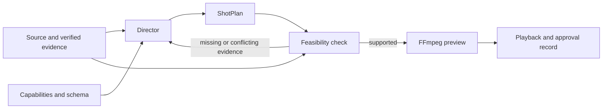

# Creative ShotComposer

ShotComposer turns a Director's selected visual sequence into a review video. The Director chooses the story, what stays visible, how each shot is composed, and when the view changes. The compositor checks the choices against a separate source evidence ledger, then renders them through the existing FFmpeg backend and selected audio track.



## Give a Director the editing tools

Use Python 3.11 or newer, FFmpeg with libx264 and libass, and the existing Director extra. Both `chomp shots` and `chomp director shots` work. A Director in Codex, Claude, another provider or a local model can consume the same files.

```powershell
python -m pip install -e '.[director]'
python -m chomp director shots capabilities
python -m chomp director shots schema --kind plan
```

There are two ways to supply the Director's decisions.

1. Prepare a pack and give it to the Director. It includes the requested time range and canvas, the supported operators, the plan schema, the source ledger and instructions. Pass an existing EDIT-01 bundle with `--bundle` to include its verified PNG frames and story evidence. If you already have a selected storyboard from that bundle, add `--editorial` and use its exact selected range. Supply reviewed source regions with `--evidence` for creative crops and layouts.
2. Convert an existing `chomp-editorial/1` storyboard with `from-director`. Give it the original bundle and bindings from its image region IDs to reviewed source interval IDs. The command preserves the Director's sequence, exact range, purposes and identities. Its default slots contain the bound view. Use a native plan to direct more exact slot placement and motion.

```powershell
$source = 'D:\AI _Clipper\chomp-chomp\AI_Clipper-Chomp-Chomp-\test.mp4'
python -m chomp director shots prepare --source $source --out 'outputs\shot-pack' --start-ms 73350 --end-ms 90170 --fps 60 --rights-ref 'User-provided recording for private review' --acknowledge-permission
```

Without a supplied region ledger the pack includes only source dimensions and a context view. `prepare` is local and returns files you can hand to the Director. The ordinary VOD discovery command is independent. Choose the highlights first, then prepare an editing request for a selected interval.

Save the Director's response as a separate `chomp-shot-plan/1` file. Use the pack's evidence ledger exactly as supplied. Its canonical SHA-256 appears in `request.json`.

```powershell
python -m chomp director shots validate --source $source --plan 'outputs\director.shots.json' --evidence 'outputs\shot-pack\evidence.json'
python -m chomp director shots render --source $source --plan 'outputs\director.shots.json' --evidence 'outputs\shot-pack\evidence.json' --out 'outputs\director-preview-01'
```

The existing storyboard flow takes an additional controller binding file.

```powershell
python -m chomp director shots from-director --source $source --editorial 'outputs\editorial.json' --bundle 'outputs\bundle\evidence.json' --evidence 'outputs\reviewed-evidence.json' --bindings 'outputs\bindings.json' --out 'outputs\lowered-01'
```

`bindings.json` contains `schema_version: chomp-shot-bindings/1`, canonical `editorial_plan_sha256`, canonical `evidence_sha256`, a `regions` object from image IDs to interval IDs, `reviewer`, and `review_reference`. Refer to the verified source interval for every binding. The adapter checks source/audio metadata, subject identity, compatible region roles, and the cited location. It requires a native plan with a reviewed path for pan or tracking intent.

## Source evidence and shot clocks

The controller owns the `chomp-shot-evidence/1` ledger. It contains the source hash, rotation, pixel aspect ratio, dimensions, duration, stream selection, region boxes, time spans, and observation provenance. The Director provides `chomp-shot-plan/1` that references those IDs. Both contracts live in `chomp/director/contracts`. The plan schema bounds operators and accepts only typed parameters. Free text is stored as metadata.

Source boxes use display orientation after rotation and before sample aspect ratio correction. Times are integer source milliseconds. Each requested boundary maps to the first frame at or after it on a rational output frame grid. The report stores the requested milliseconds, corresponding frame index and realized timestamp. Sources with variable frame rate use FFmpeg's single CFR normalization step. That step can duplicate a held source frame or drop frames between output grid positions.

Source dimensions confirm the `source_bounds` region. A full-source view contains those complete bounds. A semantic region needs a named reviewer and provenance over its relevant interval. `human_interval` records a human observation. `decoded_interval` records an external check of decoded geometry over a defined interval. Both are controller assertions and should refer to the actual supporting artifact. Image samples and FX02 samples can support editorial reasoning, and require interval verification before they can certify a shot. Keep inferred, hypothesized and unverified observations distinct.

Use `attach-tracking --source ... --evidence ... --edit ... --out ...` with a saved FX02 edit to preserve tracker loss, partial and source overlay visibility states, plus the original masks and cut boundaries. Region references for a tracked subject still need valid interval geometry. A source overlay that covers a required target blocks that shot. If the detector loses a target, a reviewed interval may resolve the geometry while retaining the detector warning. The Director chooses how to show the available source.

The validated evidence hash is `chomp.artifacts.artifact_key(evidence)`. It represents canonical JSON. The preview separately records exact file hashes. Use `variants` to assess up to three alternatives for the same range and explicitly choose one. Use `revise` to record a replacement plan with the parent hash and a new revision number. The old plan remains executable for its original range and evidence revision.

## Visual operators

| Family | Director controls | Conditions |
| --- | --- | --- |
| Layout | Streamer and game, game only, streamer only, evidence and streamer, side by side or stacked people, inset, object detail, full source, IRL, and no webcam | One to four explicit slots, checked against region roles. Different layouts can use different placements. |
| Shot | Holds, source-grounded cuts and returns | Up to 12 shots in a continuous interval of up to 60 seconds. Very brief shots are flagged for playback. |
| Camera | Reviewed crop path, centered punch in, pull out, and return | Up to 200 path keys and eight zoom keys. Zoom ranges from 1 to 1.35 with linear or eased progress. Protect the target throughout. |
| Graphic | Outline, pointer and spotlight | Up to two effects in a held view. Cite a visible target and give a reason and duration. The pointer needs free room beside the target. |
| Transition | Hard cut and same-source dissolve | 50–400 ms dissolve, within the incoming shot and supported by both views at the same source times. |
| Further work | Time edits, audio mixing and cues, kinetic captions, text overlays, licensed assets, circles, wipes and slides | See the capability outcome and phase owner. Required unimplemented requests block the plan. Optional requests are listed separately in the render report. |

Each slot binds a source `region_id` to an even pixel destination rectangle `[x,y,w,h]`. Slots are ordered from back to front. Choose `contain` for the full region or `cover` for a crop that fills the slot. For a wide camera container, the subject's head and shoulders can be a separate required region inside the cover crop. Declare the action and HUD regions essential to reading the clip. If a required box would be cropped, too small or covered by another slot or a reserved caption area, the validator reports the conflict. It also bounds the swept area of moving boxes. Actual output rounding and caption raster bounds remain part of playback review.

## Render and review

FFmpeg normalizes the selected source video once. Each slot does crop, aspect ratio correction, and fit. A slot can use a reviewed pan or centered zoom. The compiler uses a stack for tiles that fill the canvas, and composites other panels and insets over a source-clock matte. It only processes views for their active frames. During a dissolve both views advance through the same source frames. The compiler blends those views for that shared window, concatenates disjoint frame windows and assigns their rational frame times. The selected audio goes through the existing continuous AAC pipeline and has its own duration limit.

A render generates a new directory with the plan, evidence, preview MP4, probe report and playback page. The existing subtitle layer can burn an operator-supplied clip-local SRT when the plan declares exclusion zones. Use `--captions <file>` and the chosen `--caption-position`. Watch the subtitles over the rendered scene to confirm their actual placement.

After playback, the existing `chomp approve` can record a review of those specific artifacts. The manifest binds the video, plan, evidence, report and optional SRT hashes.

```powershell
python -m chomp approve --review 'outputs\director-preview-01\review.json' --reviewer 'Your name' --watched --out 'outputs\director-preview-01\approval.json'
```

`compile` displays the video graph and frame mapping without rendering. `validate`, `compile`, and `render` return exit code 2 for a blocked or review-required plan and 1 for malformed input or an execution error.

Existing v0.5 edit specs continue to use `chomp rerender`. `chomp shots migrate` can archive a complete v0.5 edit with its canonical hash. Native conversion of the old blur and temporal layout semantics still requires source geometry and a matched comparison.

The verification results and exact local reproduction commands are in [EDIT-FX-03](../tasks/EDIT-FX-03.md). The design choices and source audits are in [the ShotComposer research](shotcomposer-research.md).
